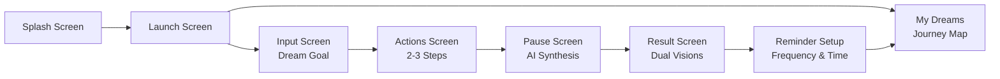
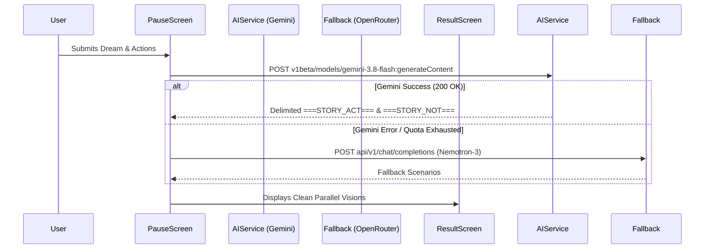

# 🌌 Ufuq | أُفُـق

<div align="center">


**Turn your life dreams into grounded action steps, project parallel futures, and ascend toward your horizon.**

[](https://flutter.dev)
[](https://dart.dev)
[](https://ai.google.dev/)
[](https://openrouter.ai/)
[](LICENSE)
[](https://flutter.dev)

</div>

---

## 📖 Table of Contents
- [✨ Core Philosophy](#-core-philosophy)
- [🌟 Key Features](#-key-features)
- [📱 Screen-by-Screen Flow](#-screen-by-screen-flow)
- [🗺️ Journey Map & Custom Canvas](#️-journey-map--custom-canvas)
- [🤖 AI Orchestration & Dual Narratives](#-ai-orchestration--dual-narratives)
- [🔔 Local Reminders & Reboot Persistence](#-local-reminders--reboot-persistence)
- [🛡️ 3-Layer Input Gatekeeper](#️-3-layer-input-gatekeeper)
- [📂 Project Architecture](#-project-architecture)
- [🚀 Quick Start & Setup](#-quick-start--setup)
- [🔒 Privacy & Security Model](#-privacy--security-model)
- [⚖️ MIT License](#️-mit-license)

---

## ✨ Core Philosophy

> **"الأفق ليس مجرد خط بعيد، بل مسار يبدأ بخطوتك القادمة."**  
> *(The horizon is not merely a distant line, but a trajectory that begins with your very next step.)*

**Ufuq (أُفُـق)** is a calm, contemplative mobile experience designed to overcome decision paralysis and vague daydreaming. Instead of empty affirmations or predictive fortune-telling, Ufuq invites you to articulate one genuine life aspiration, commit to **2 to 3 concrete actions**, and immediately witness two grounded parallel futures:

1. **The Path of Action**: A vivid, second-person narrative detailing what happens when you follow your chosen steps—including real friction, plausible obstacles, and how you work through them.
2. **The Quiet Drift (If Nothing Changes)**: A concise, honest look at what continues if you stay still, preserving perspective without guilt or catastrophe.

From there, Ufuq transforms your goal into an **ascending mountain quest map**, keeping you gently anchored with local notifications keyed to your next active milestone.

---

## 🌟 Key Features

| Feature | Description |
| :--- | :--- |
| **⛰️ Mountain Ascent Map** | An interactive canvas where milestones are stations along an illuminated, winding golden trail leading to a moonlit summit. |
| **🪞 Dual Parallel Futures** | Grounded reflective fiction generated via Gemini 3.8 Flash (with OpenRouter fallback) that mirrors your exact dialect. |
| **⚡ Next-Step Reminders** | Local notification engine that intelligently updates its message as you check off milestones, always pointing to the next step. |
| **🛡️ Intent Gatekeeper** | Custom 3-layer semantic filter that politely rejects trivial dilemmas (e.g. "pizza or salad") and honors real life goals. |
| **🌍 Native Multilingual** | First-class dialect detection and typography for **Tunisian Derja (تونسي)**, **Modern Standard Arabic**, **French**, and **English**. |
| **🔒 100% On-Device Privacy** | Zero cloud database, zero tracking SDKs, zero accounts. All saved dreams and checklists remain inside local `SharedPreferences`. |

---

## 📱 Screen-by-Screen Flow



### 1. Splash Screen (`SplashScreen`)
* Displays the custom **Ufuq Horizon Monogram** with smooth ambient scaling and fade transitions.
* Loads environment variables (`.env`) and initializes the timezone database and local notification daemon.

### 2. Launch Screen (`LaunchScreen`)
* Minimalist entrance featuring the glowing `UFUQ` title, tagline, and entry triggers.
* Provides immediate access to **Begin** a new journey or visit **My Dreams** (`HistoryScreen`).

### 3. Dream Input (`InputScreen`)
* A serene typography interface accepting between 20 and 300 characters.
* Dynamic text direction detection (`RTL` / `LTR`) based on character script.
* Validates inputs through the 3-layer `InputValidator` before unlocking progress.

### 4. Action Commitment (`ActionsScreen`)
* Prompts the user for 2 or 3 specific, verifiable actions.
* Includes a **"Suggest small actions"** button powered by keyword matching (writing, fitness, or universal starter tasks).
* Enforces explicit user review and confirmation before continuing.

### 5. Contemplation & Synthesis (`PauseScreen`)
* A calming, breathing transition screen that prevents cognitive rushing.
* Queries **Gemini 3.8 Flash** via REST; falls back to **OpenRouter Nemotron** if network or quota limits arise.
* Enforces a minimum 3-second breathing duration with animated phased status updates.

### 6. Parallel Visions (`ResultScreen`)
* Two tabbed narratives:
  * **"If you do the work"**: Realistic progression through your chosen actions with one specific obstacle overcome, followed by your explicit checklist recap.
  * **"If nothing changes"**: A concise (~40% length) portrait of inertia without apocalyptic dramatization.
* Saves dream package to `LocalStore` and progresses to notification setup.

### 7. Reminder Configuration (`ReminderSetupScreen`)
* Configures local recurring alarms: **Daily**, **Weekdays (Mon–Fri)**, or **Weekly (Specific Day)** at a chosen time.
* Seamlessly requests Android 13+ `POST_NOTIFICATIONS` or iOS alert/sound permissions.

### 8. My Dreams Journey (`HistoryScreen`)
* Complete journey dashboard featuring a horizontal carousel for switching between dreams.
* An interactive quest map with milestone stations, dynamic progress illumination, and a "Steps & Vision" bottom drawer.

---

## 🗺️ Journey Map & Custom Canvas

The **My Dreams** screen features a bespoke procedural CustomPainter ([`DreamMapPainter`](lib/widgets/dream_map_painter.dart)) drawn over serene twilight art:

```
                      [ ⚑ Summit Station: Mountain Peak ]
                                      ^
                                     / (Illuminated Golden Beam)
                     [ (3) Stage 3 Milestone Station ]
                                    /
                                   / (Organic S-Curve)
                   [ (2) Stage 2 Milestone Station ]
                                  /
                                 / (Glowing Traveler Spark)
                 [ (1) Stage 1 Milestone Station ]
                                ^
                                | (Base Entrance)
```

* **Unified Milestone Stations**: Each stage is an interactive frosted-glass capsule directly connected to the path. No disconnected checkboxes or misaligned markers.
* **Progressive Illumination**: Completed segments ignite into a radiant amber-gold light beam with moving stardust sparks.
* **Summit Radiance**: Checking off all milestones triggers a celebratory golden starburst and victory banner (`★ SUMMIT CONQUERED ★`).
* **Realm Selector**: Toggle between three curated atmospheric themes:
  1. **Serene Twilight** (`serene_dream_bg.jpg`): Calm starry sky with crescent moon and mountain mist.
  2. **Stepping Stones** (`simple_path_bg.jpg`): Stylized minimalist ascending road.
  3. **Floating Islands** (`dream_path_map.png`): Fantasy floating islands at dusk.

---

## 🤖 AI Orchestration & Dual Narratives



### Prompt Engineering Principles
* **Second-Person Voice**: Directly addresses the user (`"You set the alarm for 6:00 AM..."`).
* **Dialect & Script Mirroring**: Strictly detects and responds in the user's dialect (Tunisian Derja, Arabic, French, English).
* **Anti-Hype Grounding**: Explicitly forbids superlatives, guaranteed wealth/fame, percentage odds, or corporate motivational clichés.
* **Obstacle Mandate**: Forces the narrative to introduce one realistic stumbling block and how the user realistically navigates it.
* **Concise Inaction**: The "if nothing changes" scenario is strictly prompted to be ~40% as long as the primary scenario.

---

## 🔔 Local Reminders & Reboot Persistence

Ufuq uses zero external push servers. Reminders are 100% on-device alarms powered by `flutter_local_notifications` and the `timezone` database:

* **Dynamic Text Generation**:
  * Reminders dynamically compute the user's first unchecked action (`dream.nextStep`).
  * If **Stage 1** is pending: `"Next step: [Your Stage 1 Action]"`.
  * Once **Stage 1** is checked off, the alarm automatically updates to: `"Next step: [Your Stage 2 Action]"`.
  * When **All Stages** are complete, the alarm gently notifies: `"You have completed these steps. Add new steps for your dream."`
* **Multilingual Notification Templates**:
  * **Arabic**: `لا تنس حلمك: [العنوان]` $\rightarrow$ `خطوتك التالية: [الخطوة]`
  * **French**: `N’oubliez pas votre rêve : [Titre]` $\rightarrow$ `Prochaine étape : [Étape]`
  * **English**: `Don't forget your dream: [Title]` $\rightarrow$ `Next step: [Action]`
* **Reboot Resilience**:
  * Android Manifest registers `ScheduledNotificationBootReceiver` listening for `BOOT_COMPLETED`, `MY_PACKAGE_REPLACED`, and `QUICKBOOT_POWERON`.
  * On every app launch, `main()` re-evaluates all saved entries in `LocalStore` and reschedules alarms to guarantee zero dropped reminders.

---

## 🛡️ 3-Layer Input Gatekeeper

A serious product is defined by what it refuses to process. Ufuq implements a 3-layer validation pipeline:

```
[User Input]
     │
     ▼
┌─────────────────────────────────────────────────────────────┐
│ LAYER 1: Intent Gatekeeper (intent_gatekeeper.dart)         │
│ • Rejects trivial daily queries (pizza vs burger, weather)  │
│ • Detects real life verbs & uncertainty indicators          │
└─────────────────────────────────────────────────────────────┘
     │ (Pass)
     ▼
┌─────────────────────────────────────────────────────────────┐
│ LAYER 2: Spam & Gibberish Filter (input_validator.dart)     │
│ • Flags keyboard row spam (asdfghjkl, zxcvbnm)              │
│ • Enforces vowel-to-consonant ratios & unique char ratio    │
└─────────────────────────────────────────────────────────────┘
     │ (Pass)
     ▼
┌─────────────────────────────────────────────────────────────┐
│ LAYER 3: Character Boundary Enforcer                        │
│ • Enforces 20 <= length <= 300 characters                   │
└─────────────────────────────────────────────────────────────┘
     │ (Pass)
     ▼
[Proceed to Action Decomposition]
```

---

## 📂 Project Architecture

```
lib/
├── app_config.dart                  # Global brand constants: Ufuq (أفق)
├── main.dart                        # Entry point, theme binding, dotenv & notification init
├── models/
│   └── dream.dart                   # Immutable Dream, DreamAction, and DreamReminder models
├── screens/
│   ├── about_screen.dart            # Ethos and privacy manifesto
│   ├── actions_screen.dart          # 2-3 step commitment with smart suggestion engine
│   ├── history_screen.dart          # My Dreams dashboard with procedural quest map
│   ├── input_screen.dart            # Dream capture with real-time RTL detection
│   ├── launch_screen.dart           # Welcoming home interface
│   ├── pause_screen.dart            # Calming transition & AI dual-engine dispatch
│   ├── reminder_setup_screen.dart   # Alarm frequency and local time configuration
│   ├── result_screen.dart           # Dual parallel visions with tabbed comparison
│   └── splash_screen.dart           # Animated horizon logo presentation
├── services/
│   ├── ai_service.dart              # Primary Google Gemini 3.8 Flash REST client
│   ├── fallback_service.dart        # Fallback OpenRouter Nemotron-3 REST client
│   ├── input_validator.dart         # Syntactic spam, repetition, and length verification
│   ├── intent_gatekeeper.dart       # Semantic classifier filtering trivial non-stakes queries
│   └── reminder_service.dart        # Inexact local notifications with timezone awareness
├── storage/
│   └── local_store.dart             # Local repository wrapping SharedPreferences
├── theme/
│   └── app_theme.dart               # Golden dreamscape palette & Playfair Display typography
└── widgets/
    ├── ambient_background.dart      # Cosmic radial gradient background wrapper
    ├── dream_button.dart            # Tactile golden CTA button
    ├── dream_horizon.dart           # Twilight landscape shader animation
    ├── dream_map_painter.dart       # High-performance procedural S-curve journey painter
    └── parallel_path_animation.dart # Dual path branching visual
```

---

## 🚀 Quick Start & Setup

### Prerequisites
* **Flutter SDK**: `>= 3.10.3`
* **Dart SDK**: `>= 3.0.0`
* Google Gemini API Key (free tier supported)

### 1. Clone & Install
```bash
git clone https://github.com/your-username/ufuq.git
cd ufuq
flutter pub get
```

### 2. Configure Environment Variables
Create a `.env` file in the project root:
```env
# Primary AI Engine (Gemini 3.8 Flash)
GEMINI_API_KEY=your_gemini_api_key_here

# Optional Fallback Engine (OpenRouter)
OPENROUTER_API_KEY=your_openrouter_api_key_here
```
> **Note**: `.env` is ignored by Git and will never be committed to source control.

### 3. Generate Native Launcher Icons
```bash
dart run flutter_launcher_icons
```

### 4. Run the Application
```bash
# Debug Mode
flutter run

# Run Analyzer
flutter analyze

# Run Test Suite (25 Tests)
flutter test
```

---

## 🔒 Privacy & Security Model

* **Zero Cloud Accounts**: There is no login, email collection, phone number verification, or password database.
* **On-Device Storage**: Dreams, custom steps, checklist timestamps, and reminder preferences are stored exclusively on your device via `SharedPreferences`.
* **Minimal Network Footprint**: The network is only touched when generating scenarios (sending your dream text to Gemini/OpenRouter) and downloading typography files via `google_fonts`.
* **Zero Analytics**: No Google Analytics, Firebase, Mixpanel, or telemetry trackers are integrated.

---

## ⚖️ MIT License

```
MIT License

Copyright (c) 2026 Maher Ahmed

Permission is hereby granted, free of charge, to any person obtaining a copy
of this software and associated documentation files (the "Software"), to deal
in the Software without restriction, including without limitation the rights
to use, copy, modify, merge, publish, distribute, sublicense, and/or sell
copies of the Software, and to permit persons to whom the Software is
furnished to do so, subject to the following conditions:

The above copyright notice and this permission notice shall be included in all
copies or substantial portions of the Software.

THE SOFTWARE IS PROVIDED "AS IS", WITHOUT WARRANTY OF ANY KIND, EXPRESS OR
IMPLIED, INCLUDING BUT NOT LIMITED TO THE WARRANTIES OF MERCHANTABILITY,
FITNESS FOR A PARTICULAR PURPOSE AND NONINFRINGEMENT. IN NO EVENT SHALL THE
AUTHORS OR COPYRIGHT HOLDERS BE LIABLE FOR ANY CLAIM, DAMAGES OR OTHER
LIABILITY, WHETHER IN AN ACTION OF CONTRACT, TORT OR OTHERWISE, ARISING FROM,
OUT OF OR IN CONNECTION WITH THE SOFTWARE OR THE USE OR OTHER DEALINGS IN THE
SOFTWARE.
```
